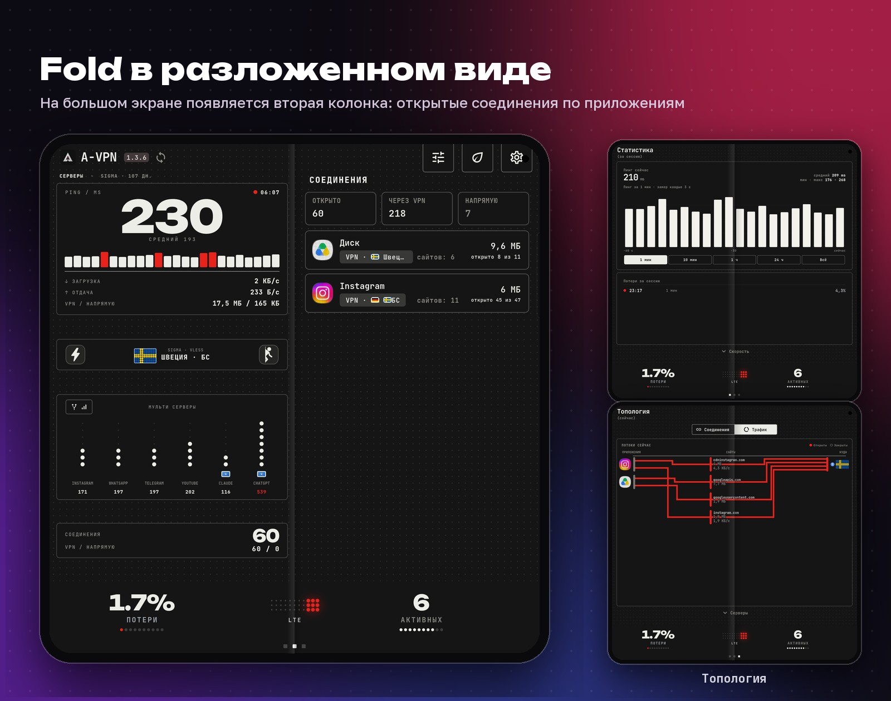

<p align="center">
  
</p>

<h1 align="center">A-VPN</h1>

<p align="center">
  <b>VPN, который сам переходит между LTE и Wi-Fi.</b><br>
  Без разрыва и без нажатий. Android, Fold и Windows, ядро sing-box, без телеметрии.
</p>

<p align="center">
  <a href="https://github.com/Aramikkk/A-VPN/releases/latest"></a>
  <a href="https://github.com/Aramikkk/A-VPN/releases"></a>
  
  
  <a href="LICENSE.md"></a>
</p>

<p align="center">
  <b>Русский</b> · <a href="#english">English</a>
</p>

<p align="center">
  
</p>

> A-VPN — независимый форк [Hiddify](https://github.com/hiddify/hiddify-app), выпущенный по условиям его лицензии. Он не связан с командой Hiddify и не одобрен ею.

## Главная фича: автопереход между LTE и Wi-Fi

<p align="center">
  
</p>

Вышли из дома, зашли в метро, подключились к Wi-Fi: приложение само замечает смену сети и переключается. VPN не отключается, соединения не рвутся, а серверы и страны меняются на те, что выбраны для новой сети: обычные в Wi-Fi, для белых списков (БС) в LTE. Нажимать ничего не нужно.

## Скачать

| Платформа | Файл |
|---|---|
| Android 7+, arm64 | `A-VPN-<версия>-arm64.apk` |
| Windows 10+, x64 | `A-VPN-Setup-<версия>-windows.exe` |

**[Последний релиз](https://github.com/Aramikkk/A-VPN/releases/latest)**. Потом добавьте подписку: «Профили» → «+». Проверка подписи и сумм: [ниже](#установка-и-проверка).

## Ещё фичи

<p align="center">
  
</p>

## Подписки

<p align="center">
  
</p>

Подписок можно добавить сколько угодно: серверы собираются в один список. Подписки включаются и выключаются, меняются местами, одну можно сделать приоритетной.

## На всех экранах

<p align="center">
  
</p>

<p align="center">
  
</p>

## Доступ к ИИ

<p align="center">
  
</p>

Постоянный адрес помогает реже терять сессии и попадать под ограничения, гарантировать доступ нельзя: решает сам сервис. Включается отдельно для Wi-Fi и LTE: «Настройки» → «Сайты».

## Возможности

<p align="center">
  
</p>

<details>
<summary><b>Все возможности списком</b></summary>

**Серверы**
- Несколько подписок в одном списке: порядок перетаскиванием, переключатель «в работе», одну можно сделать приоритетной.
- Автовыбор по минимальной задержке, отдельный допуск для Wi-Fi и мобильной сети.
- Молния: проверяет все серверы и ставит самый быстрый. Если он перестаёт отвечать, выбор возвращается на Авто.
- Режим «Меньше прыжков»: выбранный сервер остаётся, пока стабилен, проверки идут реже.
- Свой сервер для выбранных сервисов и приложений с замером задержки до каждого.

**Маршрутизация**
- «Только заблокированное через VPN»: остальное идёт напрямую.
- Раздельное туннелирование по приложениям и доменам, готовые группы для российских сервисов, банков и маркетплейсов.
- Блокировка рекламы, трекеров, фишинга и майнеров на уровне VPN.
- Автопауза: VPN выключается, пока на экране приложение из вашего списка, и включается снова.
- Домашний Wi-Fi: если на роутере уже свой VPN, приложение приостанавливается и возвращается вне дома. Геолокация не нужна.

**Статистика**
- Топология: куда ушёл трафик (VPN, напрямую, заблокировано) и через какие страны.
- Серверы: объём и время по каждому за сессию, сутки, месяц и всё время.
- Задержка и потери с историей, трафик по приложениям.

**Работа в фоне**
- **Суперлайт** (кнопка с листом): остаётся главная с пингом, потерями и скоростью, остальное выключено. Для слабых телефонов и батареи.
- Ночной режим: реже опросы, меньше пробуждений.
- Уведомление не обновляется, пока экран выключен.
</details>

## Интерфейс

<p align="center">
  
</p>

<p align="center">
  
</p>

<p align="center">
  
</p>

<sub>Четыре стиля показаны с примерными данными, остальные кадры сняты в приложении.</sub>

## Установка и проверка

- **Android 7+, arm64:** `A-VPN-<версия>-arm64.apk`. Android попросит разрешить установку из этого источника.
- **Windows 10+, x64:** `A-VPN-Setup-<версия>-windows.exe`. Установщик не подписан сертификатом издателя, поэтому SmartScreen может предупредить: сверьте сумму (`sha256sum -c <файл>.sha256`) и выберите «Подробнее» → «Выполнить в любом случае».

Все APK подписаны одним ключом, SHA-256 сертификата (`apksigner verify --print-certs`):

```
95:CC:05:9F:8E:1A:E2:E0:B8:59:43:66:6E:C4:5D:D3:2D:66:F8:1E:80:7B:3F:6E:7A:D6:CD:75:BE:A6:B1:9A
```

Раз в сутки приложение смотрит `latest.json` в последнем релизе и предлагает обновиться. Файл качается шестью кусками сразу, докачивается после обрыва и проверяется по SHA-256.

## Приватность

Без телеметрии и аналитики; сама обращается только к github.com (обновления). Подписки и статистика хранятся на устройстве, журналы очищаются от ссылок и ключей.

## Отличия от Hiddify

Полный список: [`avpn/CHANGELOG.md`](avpn/CHANGELOG.md). Основное:

- свой интерфейс, главный экран, статистика, топология, история потерь и задержки;
- серверы по сети, приоритетная подписка, отдельные серверы для сервисов, маршрутизация «только заблокированное»;
- патчи ядра поверх `hiddify-core` 5.4.0 ([`avpn/core54-patches`](avpn/core54-patches)): смена сети без разрыва, статистика трафика, группы сайтов;
- работа в фоне: ночной режим, проверка связи после сна, перезапуск ядра;
- версия для Windows, обновления из GitHub Releases.

## Сборка

Релизы собирает только GitHub Actions: [`release.yml`](.github/workflows/release.yml) (ядро с патчами, подписанный APK, установщик Windows). Локально нужны Flutter 3.38.5, JDK 17, Android SDK с NDK 28, Go и `gomobile`, шаги те же, что в workflow.

## Связь и лицензия

Вопросы: [Обсуждения](https://github.com/Aramikkk/A-VPN/discussions). Ошибки и предложения: [обращения](https://github.com/Aramikkk/A-VPN/issues/new/choose) (версия, устройство, журнал из «Настройки» → «Логи», без ссылки на подписку). Уязвимости: [приватно](https://github.com/Aramikkk/A-VPN/security/advisories/new).

Лицензия **Hiddify Extended GPL v3** ([`LICENSE.md`](LICENSE.md)): исходники открыты как форк [Hiddify](https://github.com/hiddify/hiddify-app), релизы собираются в GitHub Actions, в магазины приложение не выкладывается, коммерческое использование без письменного разрешения запрещено. Спасибо команде Hiddify, проекту [sing-box](https://github.com/SagerNet/sing-box) и авторам библиотек.

Проект бесплатный; добровольная поддержка: «О программе» → «Поблагодарить разработчика».

---

## English

<p align="center">
  
</p>

**A-VPN** is a VPN client for Android and Windows built on the sing-box core. It picks servers for the network you are on, switches between Wi-Fi and LTE without dropping the tunnel, and shows how the connection performs. It is an independent fork of [Hiddify](https://github.com/hiddify/hiddify-app) released under its license and is not affiliated with the Hiddify team.

- **Automatic Wi-Fi ⇄ LTE handoff (the main feature).** The app notices the network change by itself and switches servers and countries to the ones chosen for it; the VPN stays on, no taps needed.
- **As many subscriptions as you like.** All servers in one list, with a priority subscription, order and on/off switches.
- **Servers per network.** Whitelist-friendly servers on mobile data, regular ones on Wi-Fi.
- **Steady connection.** Latency and loss are measured all the time, the server is switched in good time, the link is checked after the device wakes up.
- **Windows and Fold.** The same interface in a window and on a foldable's big screen.
- Per-service servers, blocked-only routing, per-app split tunnelling, ad/tracker/phishing blocking, per-server traffic statistics, an AI group (one server plus two backups for Claude, ChatGPT and others).
- Super light mode for weak phones and the battery. No telemetry; updates come only from this repository's releases and are verified by SHA-256.

**Install:** download `A-VPN-<version>-arm64.apk` (Android 7+, 64-bit ARM) or `A-VPN-Setup-<version>-windows.exe` (Windows 10+, x64, not code-signed, so SmartScreen may warn) from the [latest release](https://github.com/Aramikkk/A-VPN/releases/latest) and verify it with the `.sha256` file and the certificate fingerprint above.
