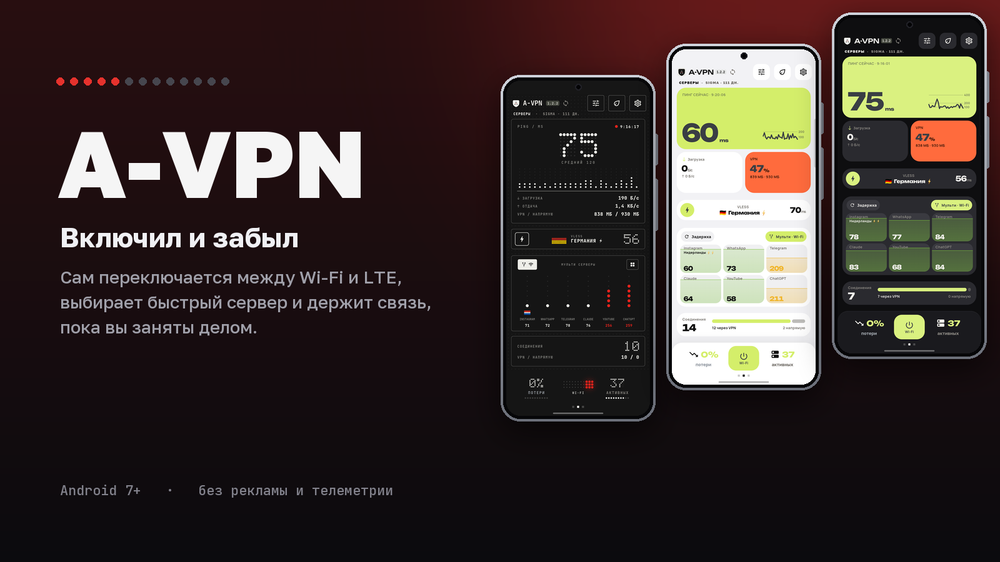
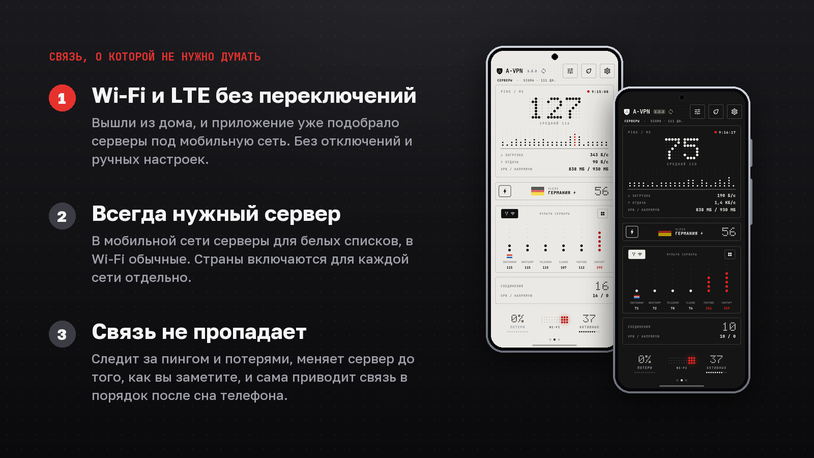
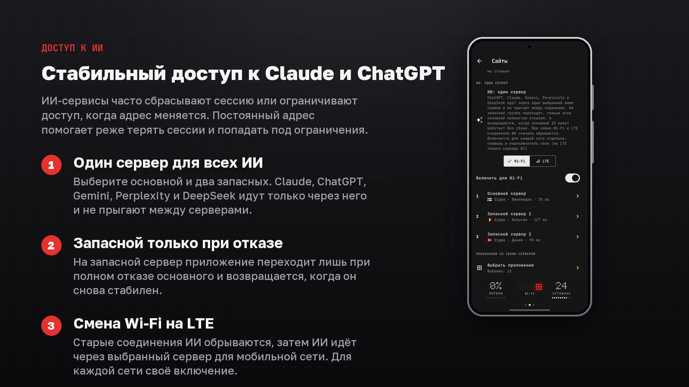
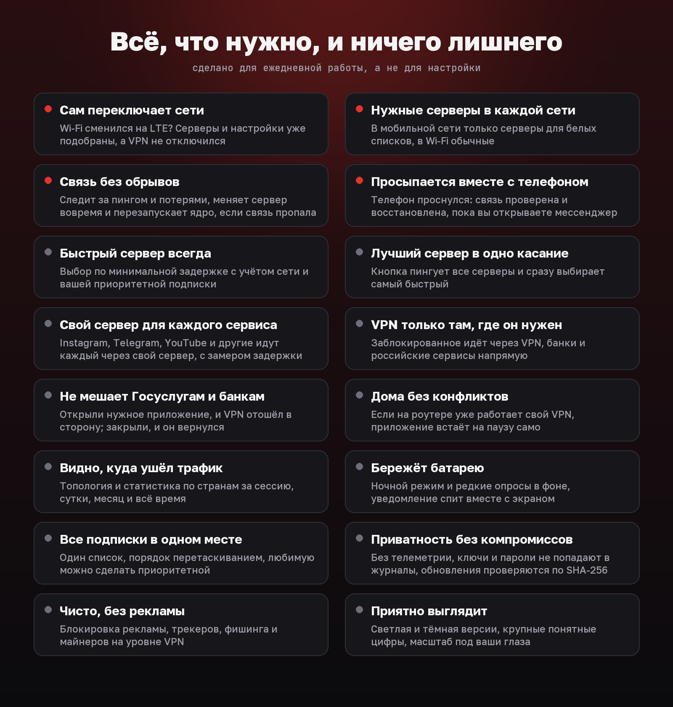
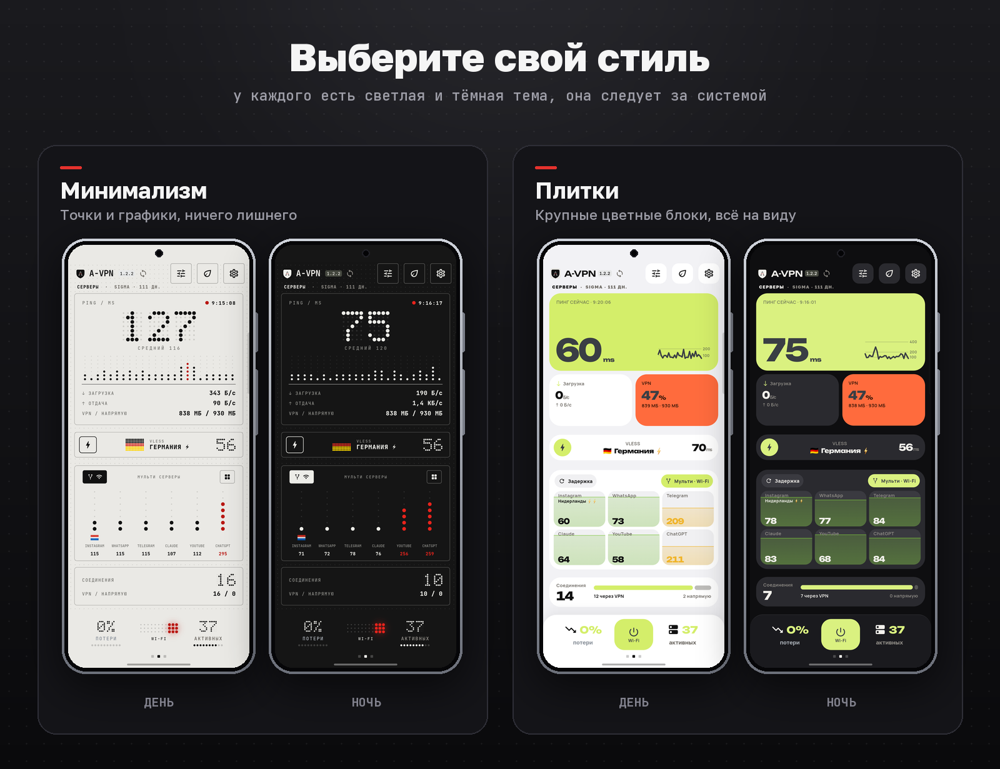
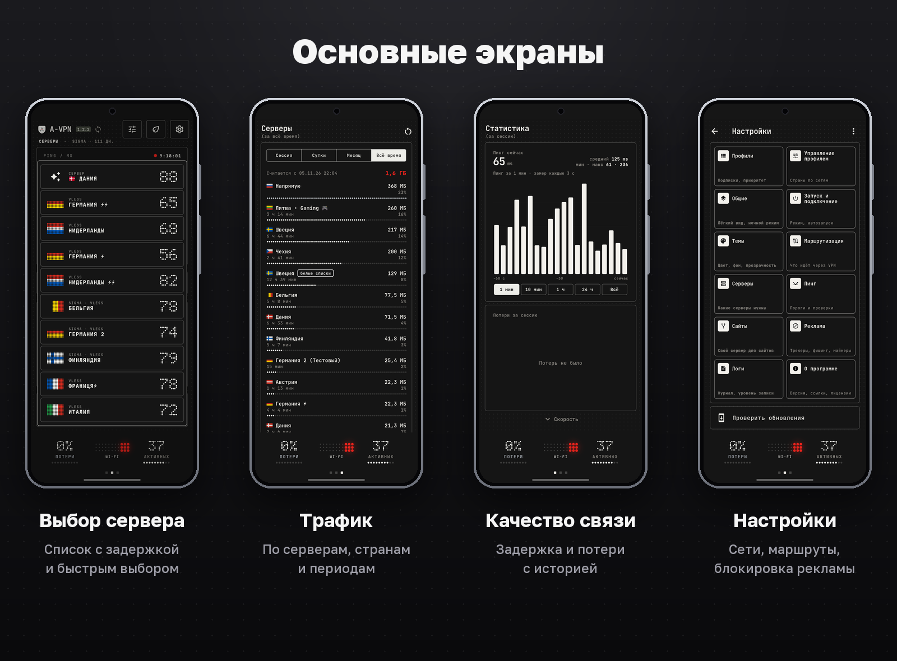
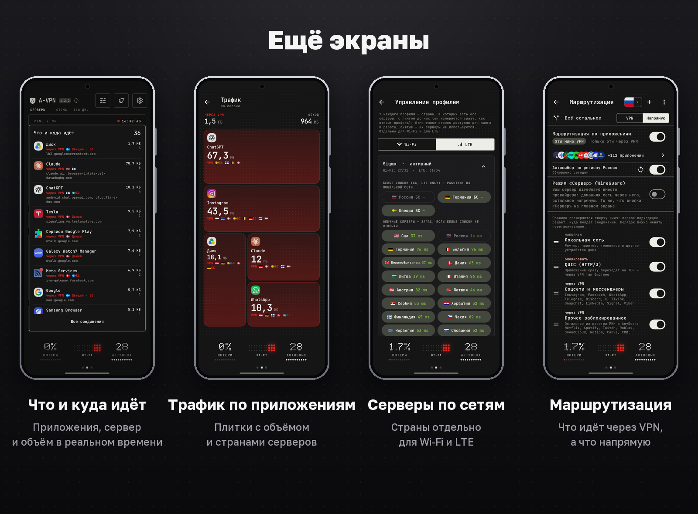

<p align="center">
  
</p>

<h1 align="center">A-VPN</h1>

<p align="center">
  Клиент для Android на ядре sing-box. Подбирает серверы под текущую сеть, переключается между Wi‑Fi и LTE без разрыва и показывает, как работает соединение.
</p>

<p align="center">
  <a href="https://github.com/Aramikkk/A-VPN/releases/latest"></a>
  <a href="https://github.com/Aramikkk/A-VPN/releases"></a>
  
  <a href="LICENSE.md"></a>
</p>

<p align="center">
  <b>Русский</b> · <a href="#english">English</a>
</p>

> A-VPN — независимый форк [Hiddify](https://github.com/hiddify/hiddify-app), выпущенный по условиям его лицензии. Он не связан с командой Hiddify и не одобрен ею.

## Главные фичи

<p align="center">
  
</p>

- **Wi‑Fi и LTE без разрыва.** Вышли из дома или подключились к Wi‑Fi: VPN не отключается и переподключается сам, нажимать ничего не нужно.
- **Свои серверы для каждой сети.** В LTE работают серверы для белых списков, в Wi‑Fi обычные. Страны для каждой сети выбираются отдельно.
- **Устойчивое соединение.** Приложение постоянно измеряет задержку и потери, вовремя меняет сервер, перезапускает ядро при потере связи и проверяет соединение после сна устройства.

## Доступ к ИИ

<p align="center">
  
</p>

ИИ-сервисы часто сбрасывают сессию или ограничивают доступ, когда адрес меняется. Выберите основной сервер и два запасных: Claude, ChatGPT, Gemini, Perplexity и DeepSeek идут только через него и не прыгают между серверами. На запасной сервер приложение переходит только при полном отказе основного, а при смене Wi‑Fi на LTE сначала обрывает старые соединения ИИ и переходит на выбранный сервер для мобильной сети. Постоянный адрес помогает реже терять сессии и попадать под ограничения, гарантировать доступ нельзя: решает сам сервис. Включается отдельно для Wi‑Fi и LTE в «Настройки → Сайты».

## Возможности

<p align="center">
  
</p>

**Серверы**
- Несколько подписок в одном списке. Порядок задаётся перетаскиванием, у каждой есть переключатель «в работе», верхняя включённая главная (её имя на главном экране), одну подписку можно сделать приоритетной.
- Автоматический выбор по минимальной задержке с отдельным допуском для Wi‑Fi и мобильной сети.
- Кнопка быстрого выбора: проверяет все серверы и выбирает самый быстрый из доступных по вашим правилам.
- Режим «Меньше прыжков»: выбранный сервер остаётся, пока стабилен, а проверки идут реже. Кнопка быстрого выбора всё равно сразу переключает на самый быстрый.
- Отдельный сервер для выбранных сервисов и приложений (Instagram, WhatsApp, Telegram, YouTube и других) с измерением задержки до каждого.

**Маршрутизация**
- Режим «только заблокированное через VPN»: остальной трафик идёт напрямую. Список обновляется.
- Раздельное туннелирование по приложениям и доменам, готовые группы для российских сервисов, банков и маркетплейсов.
- Блокировка рекламы, трекеров, фишинговых сайтов и майнеров на уровне VPN.
- Автопауза: VPN приостанавливается, пока на экране приложение из вашего списка (например, Госуслуги или банк), и включается снова.
- Домашний Wi‑Fi: если на роутере уже работает свой VPN, приложение приостанавливается и возвращается вне дома. Сеть определяется по роутеру, доступ к геолокации не нужен.

**Статистика**
- Топология: куда ушёл трафик (VPN, напрямую, заблокировано) и через какие страны.
- Серверы: объём и время по каждому серверу за сессию, сутки, месяц и весь период.
- Задержка и потери с историей, трафик по приложениям.

**Работа в фоне**
- **Суперлайт** (кнопка с листом на главном экране): остаётся только главная с пингом, потерями и скоростью, всё лишнее выключается. Замеры идут раз в 10 секунд, топология, список соединений, история скорости и проверки сайтов отключены, серверы проверяются редко. На мобильной сети мультисервер остаётся включённым: серверов там мало, нагрузка небольшая. Для слабых телефонов и экономии батареи.
- Ночной режим: реже опросы, меньше пробуждений устройства.
- Уведомление службы не обновляется, пока экран выключен.

## Интерфейс

<p align="center">
  
</p>

<p align="center">
  
</p>

<p align="center">
  
</p>

Два стиля на выбор (минимализм и плитки; есть также стеклянный и контрастный), светлая и тёмная версии, масштаб интерфейса и шрифта.

<sub>На картинках экраны статистики и топологии дополнены примерными данными, остальное снято в приложении.</sub>

## Установка

Скачайте файл из [последнего релиза](https://github.com/Aramikkk/A-VPN/releases/latest), проверьте сумму (`sha256sum -c <файл>.sha256`) и добавьте подписку: «Профили» → «+».

- **Android 7+, arm64:** `A-VPN-<версия>-arm64.apk`. Android попросит разрешить установку из этого источника.
- **Windows 10+, x64:** `A-VPN-Setup-<версия>-windows.exe`. Установщик не подписан сертификатом издателя, поэтому SmartScreen может предупредить: сверьте сумму и выберите «Подробнее» → «Выполнить в любом случае».

Все APK подписаны одним ключом, SHA‑256 сертификата (`apksigner verify --print-certs`):

```
95:CC:05:9F:8E:1A:E2:E0:B8:59:43:66:6E:C4:5D:D3:2D:66:F8:1E:80:7B:3F:6E:7A:D6:CD:75:BE:A6:B1:9A
```

Раз в сутки приложение смотрит `latest.json` в последнем релизе и предлагает обновиться; файл проверяется по SHA‑256.

## Приватность

Без телеметрии и аналитики; сама обращается только к github.com (обновления). Подписки и статистика хранятся на устройстве, журналы очищаются от ссылок и ключей.

## Отличия от Hiddify

Полный список: [`avpn/CHANGELOG.md`](avpn/CHANGELOG.md). Основное:

- свой интерфейс и главный экран, статистика, топология, история потерь и задержки;
- серверы по сети, приоритетная подписка, отдельные серверы для сервисов, маршрутизация «только заблокированное»;
- патчи ядра поверх `hiddify-core` 5.4.0 ([`avpn/core54-patches`](avpn/core54-patches)): смена сети без разрыва, статистика трафика, группы сайтов;
- работа в фоне: ночной режим, проверка связи после сна, перезапуск ядра;
- обновления из GitHub Releases; настройки под провайдера Sigma Gate вынесены в переключатель, по умолчанию выключен.

## Сборка

Релизы собирает только GitHub Actions: [`release.yml`](.github/workflows/release.yml) (ядро с патчами, подписанный APK, установщик Windows). Локально нужны Flutter 3.38.5, JDK 17, Android SDK с NDK 28, Go и `gomobile`, шаги те же, что в workflow.

## Связь и лицензия

Вопросы: [Обсуждения](https://github.com/Aramikkk/A-VPN/discussions). Ошибки и предложения: [обращения](https://github.com/Aramikkk/A-VPN/issues/new/choose) (версия, устройство, журнал из «Настройки» → «Логи», без ссылки на подписку). Уязвимости: [приватно](https://github.com/Aramikkk/A-VPN/security/advisories/new).

Лицензия **Hiddify Extended GPL v3** ([`LICENSE.md`](LICENSE.md)): исходники открыты как форк [Hiddify](https://github.com/hiddify/hiddify-app), релизы собираются в GitHub Actions, в магазины приложение не выкладывается, коммерческое использование без письменного разрешения запрещено. Спасибо команде Hiddify, проекту [sing-box](https://github.com/SagerNet/sing-box) и авторам библиотек.

Проект бесплатный; добровольная поддержка: «О программе» → «Поблагодарить разработчика».

---

## English

**A-VPN** is an Android VPN client built on the sing-box core. It picks servers for the network you are on, switches between Wi‑Fi and LTE without dropping the tunnel, and shows how the connection performs. It is an independent fork of [Hiddify](https://github.com/hiddify/hiddify-app) released under its license and is not affiliated with the Hiddify team.

- **Wi‑Fi and LTE without a break.** Servers and settings follow the network; the VPN stays on.
- **Servers per network.** Whitelist-friendly servers on mobile data, regular ones on Wi‑Fi; countries are set per network.
- **Steady connection.** Latency and loss are measured all the time, the server is switched in good time, the core restarts if the link is lost, and the connection is checked after the device wakes up.
- Per-service servers, blocked-only routing, per-app split tunnelling, ad/tracker/phishing blocking, per-server traffic statistics.
- AI group: one server of your choice (and two backups) for Claude, ChatGPT, Gemini, Perplexity and DeepSeek, per network; it moves to a backup only when the main server has failed.
- Super light mode (the leaf button): only the home screen is left, measurements every 10 s, the heavy pages and checks are off. For weak phones and the battery.
- No telemetry. Updates come only from this repository's releases and are verified by SHA‑256.

**Install:** download `A-VPN-<version>-arm64.apk` from the [latest release](https://github.com/Aramikkk/A-VPN/releases/latest) and verify it with the `.sha256` file and the certificate fingerprint above. Android 7+, 64-bit ARM only. A Windows 10+ (x64) installer, `A-VPN-Setup-<version>-windows.exe`, is attached to the same release, with its `.sha256`; it is not code-signed, so SmartScreen may warn. Source, build workflow and the core patches are in this repository.
