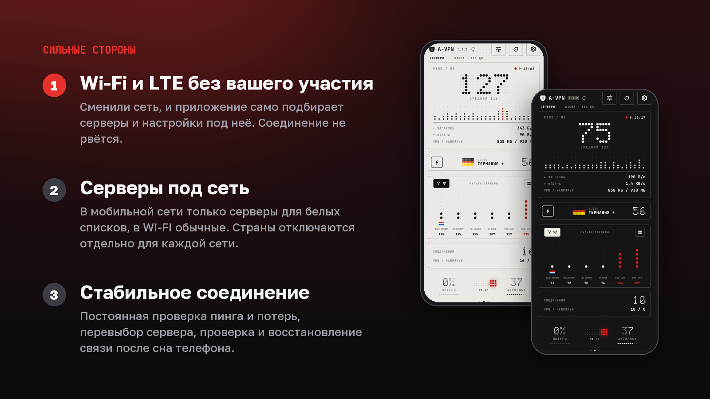
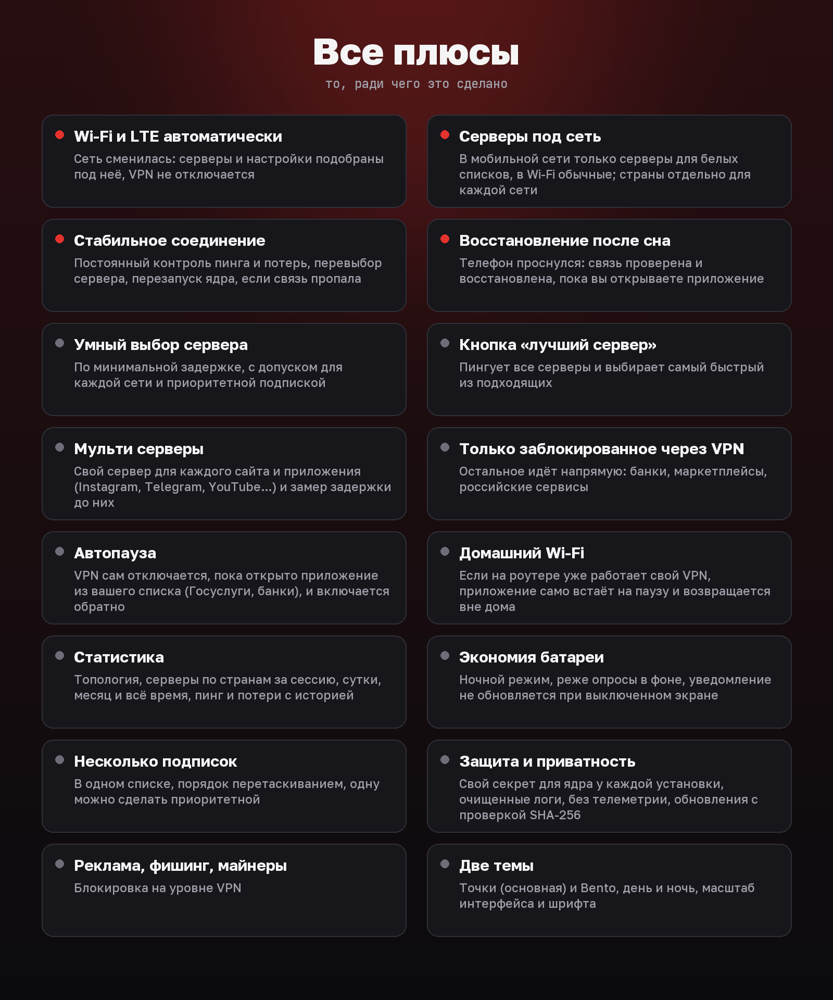
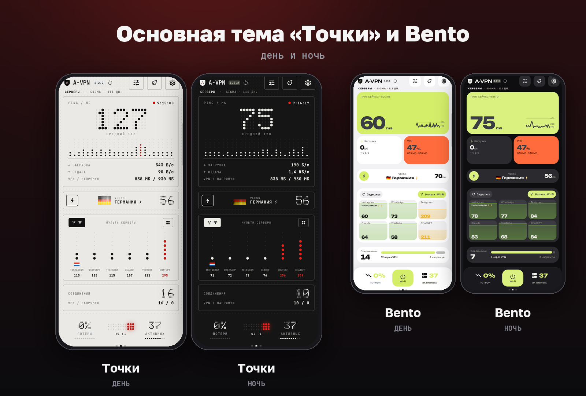
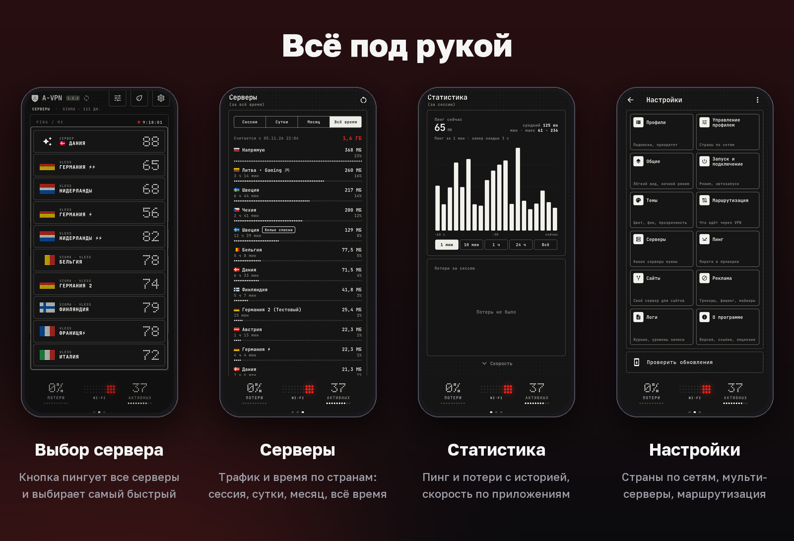

<p align="center">
  
</p>

<p align="center">
  
</p>

<p align="center">
  VPN-клиент для Android на ядре sing-box. Форк <a href="https://github.com/hiddify/hiddify-app">Hiddify</a> с собственным интерфейсом, статистикой и логикой выбора серверов.<br>
  <i>An Android VPN client on the sing-box core: a fork of Hiddify that switches between Wi-Fi and LTE by itself and keeps the connection steady. Android 7+, 64-bit ARM only.</i>
</p>

<p align="center">
  <a href="https://github.com/Aramikkk/A-VPN/releases/latest"></a>
  <a href="https://github.com/Aramikkk/A-VPN/releases"></a>
  <a href="LICENSE.md"></a>
</p>

> **A-VPN не связан с командой Hiddify и не одобрен ею.** Это независимый форк по условиям их лицензии (см. [Лицензия](#лицензия)). Оригинал: <https://github.com/hiddify/hiddify-app>.

## Сильные стороны

<p align="center">
  
</p>

- **Wi‑Fi и LTE без вашего участия.** Сеть сменилась: серверы и настройки подобраны под неё, VPN не отключается.
- **Серверы под сеть.** В мобильной сети только серверы для белых списков, в Wi‑Fi обычные; страны отключаются отдельно для каждой сети.
- **Стабильное соединение.** Постоянный контроль пинга и потерь, перевыбор сервера, перезапуск ядра, если связь пропала, проверка и восстановление связи после сна телефона.

<p align="center">
  
</p>

## Скриншоты

Основная тема «Точки», рядом Bento; у каждой есть дневной и ночной вид.

<p align="center">
  
</p>

<p align="center">
  
</p>

## Что умеет

**Подключение и выбор серверов**
- Несколько подписок сразу; порядок меняется перетаскиванием, одну можно сделать приоритетной (её серверы остаются, пока другие не быстрее на заданное число миллисекунд).
- «Авто» по минимальной задержке с допуском отдельно для Wi‑Fi и мобильной сети.
- Кнопка у текущего сервера: пингует все серверы и выбирает самый быстрый из подходящих.
- Серверы по сети: в мобильной сети только серверы для белых списков («LTE Only», «БС»), в Wi‑Fi обычные; страны можно отключать отдельно для каждой сети.
- «Мульти серверы»: отдельный сервер для каждого из выбранных сайтов и приложений (Instagram, WhatsApp, Telegram, YouTube и т. д.), с измерением задержки до каждого сайта.

**Маршрутизация**
- Режим «только заблокированное через VPN»: всё остальное идёт напрямую (встроенный список, обновляется).
- Правила по приложениям (раздельное туннелирование) и по доменам; готовые группы для российских сервисов, банков и маркетплейсов.
- Блокировка рекламы, трекеров, фишинга и майнеров на уровне VPN.
- Автопауза: VPN сам отключается, пока открыто приложение из вашего списка (Госуслуги, банки), и включается обратно.
- Домашний Wi‑Fi: если на роутере уже работает свой VPN, приложение само встаёт на паузу и возвращается вне дома (сеть определяется по роутеру, без доступа к геолокации).

**Статистика**
- Топология: какой трафик куда ушёл (VPN, напрямую, заблокировано) и через какие страны.
- «Серверы»: объём и время по каждому серверу за сессию, сутки, месяц и всё время.
- Потери и пинг с историей, трафик по приложениям.

**Интерфейс и батарея**
- Основная тема «Точки» и Bento, день и ночь, масштаб интерфейса и шрифта (в приложении есть ещё Glass и Contrast).
- Ночной режим и «лёгкая работа в фоне»: реже опросы, меньше пробуждений.
- Проверка и восстановление связи после сна телефона.

**Безопасность**
- Управление ядром идёт через локальный gRPC с случайным секретом, свой у каждой установки (другие приложения к ядру не подключатся).
- Журналы очищаются от ссылок подписок, ключей, паролей и UUID.
- Обновления берутся только из релизов этого репозитория, архив проверяется по SHA‑256.

## Установка

1. Скачайте `A-VPN-<версия>-arm64.apk` из [релизов](https://github.com/Aramikkk/A-VPN/releases/latest).
2. Проверьте контрольную сумму: рядом лежит файл `*.apk.sha256`.
   ```bash
   sha256sum -c A-VPN-<версия>-arm64.apk.sha256
   ```
3. Установите (Android попросит разрешить установку из этого источника) и добавьте свою подписку: «Профили» → «+».

**Подпись.** Все релизы подписаны одним ключом. SHA‑256 сертификата:

```
95:CC:05:9F:8E:1A:E2:E0:B8:59:43:66:6E:C4:5D:D3:2D:66:F8:1E:80:7B:3F:6E:7A:D6:CD:75:BE:A6:B1:9A
```

Проверить: `apksigner verify --print-certs A-VPN-<версия>-arm64.apk`. Если отпечаток другой, это не наша сборка.

**Только 64-битный ARM** (`arm64-v8a`): практически все телефоны последних лет. Для других процессоров (32‑битный ARM, x86) сборок нет.

Обновления приходят из самого приложения («Настройки» → «О программе»): оно раз в сутки смотрит `latest.json` в последнем релизе этого репозитория, показывает полосу «Доступна версия» и ставит файл после вашего подтверждения.

## Разрешения и приватность

| Разрешение | Зачем |
|---|---|
| `INTERNET`, `BIND_VPN_SERVICE`, `FOREGROUND_SERVICE*` | сам VPN |
| `QUERY_ALL_PACKAGES` | список установленных приложений для раздельного туннелирования и статистики по приложениям |
| `PACKAGE_USAGE_STATS` | определить приложение на экране для автопаузы VPN (по желанию) |
| `REQUEST_INSTALL_PACKAGES` | установка обновления по вашему подтверждению |
| `RECEIVE_BOOT_COMPLETED`, `REQUEST_IGNORE_BATTERY_OPTIMIZATIONS` | запуск после перезагрузки и работа в фоне |
| `POST_NOTIFICATIONS` | уведомление службы со скоростью и сервером |
| `CAMERA` | сканирование QR-кода подписки |

- Телеметрии и аналитики в сборках нет (ключ отправки отчётов не задан).
- Единственное обращение приложения «от себя»: раз в сутки запрос `latest.json` на github.com (как у любого браузера: ваш IP виден GitHub, никаких идентификаторов приложение не добавляет).
- Запросы к подписке идут к вашему провайдеру. Если его панель ограничивает число устройств, приложение передаёт случайный идентификатор установки (создаётся при первом запуске, не связан с вами).
- Всё, что вы настраиваете (подписки, списки приложений, статистика), хранится только на устройстве.

## Отличия от Hiddify

Полный список по версиям: [`avpn/CHANGELOG.md`](avpn/CHANGELOG.md). Главное:

- новый интерфейс (четыре темы), главный экран с пингом, потерями, сайтами и текущим сервером;
- страницы статистики «Топология» и «Серверы», история потерь и пинга;
- выбор серверов по сети, приоритетная подписка, мульти‑серверы по сайтам;
- маршрутизация «только заблокированное», группы российских сервисов, блокировка рекламы;
- нижний уровень: патчи к ядру ([`avpn/core54-patches`](avpn/core54-patches)) поверх `hiddify-core` 5.4.0 и `hiddify-sing-box`: горячая перезагрузка при смене сети, статистика трафика, группы сайтов;
- работа в фоне: ночной режим, проверка связи после сна, перезапуск ядра при необходимости;
- обновление из GitHub Releases;
- настройка под отдельного провайдера (Sigma Gate: название «Sigma» вместо «Доступ», запрос подписки как Clash Meta) включается отдельным переключателем в «Общие» и по умолчанию выключена.

Ядро собирается из исходников `hiddify-core` и `hiddify-sing-box` (подробности в [`avpn/core54-patches/README.md`](avpn/core54-patches/README.md)).

## Сборка

Релизы собирает только GitHub Actions ([`.github/workflows/release.yml`](.github/workflows/release.yml)): ядро с патчами, затем подписанный APK. Для запуска в репозитории нужны секреты `ANDROID_KEYSTORE_BASE64`, `ANDROID_KEYSTORE_PASSWORD`, `ANDROID_KEY_ALIAS`, `ANDROID_KEY_PASSWORD`.

Локально: Flutter 3.38.5, JDK 17, Android SDK с NDK 28, Go (версия из `go.mod` ядра) и `gomobile`. Шаги те же, что в workflow.

```bash
flutter pub get
dart run slang
dart run build_runner build --delete-conflicting-outputs
flutter test
```

## Лицензия

Проект распространяется по **Hiddify Extended GNU GPL v3** ([`LICENSE.md`](LICENSE.md)): GPL v3 с дополнительными условиями Hiddify.
Кратко: исходный код открыт и опубликован как форк Hiddify; релизы собираются в GitHub Actions; указана атрибуция Hiddify (<https://github.com/hiddify/hiddify-app>); приложение не публикуется в магазинах приложений; коммерческое использование без письменного разрешения запрещено; производные работы распространяются на тех же условиях. Условия полностью в `LICENSE.md`, они обязательны.

Спасибо команде [Hiddify](https://github.com/hiddify), проекту [sing-box](https://github.com/SagerNet/sing-box) и всем авторам библиотек, на которых это построено.

## Поддержать разработчика

Это личный проект, он бесплатный и таким останется. Если приложение пригодилось, в «О программе» есть раздел «Поблагодарить разработчика» с реквизитами. Это добровольно и ни на что не влияет.
