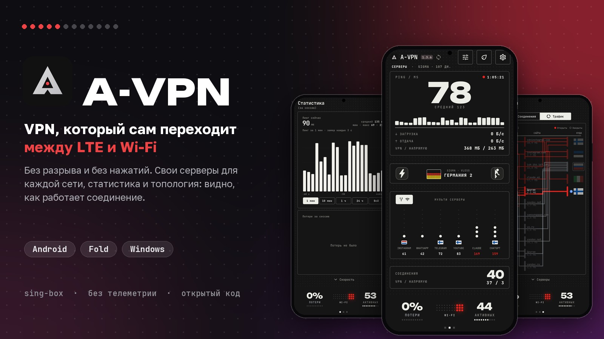
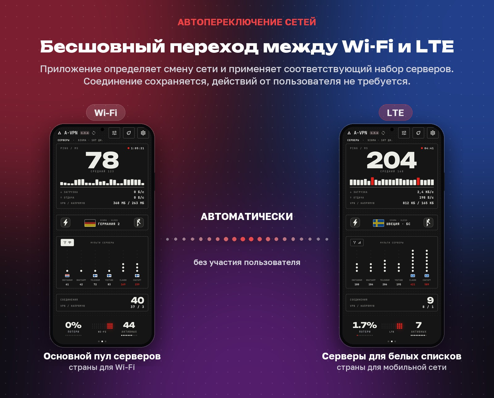
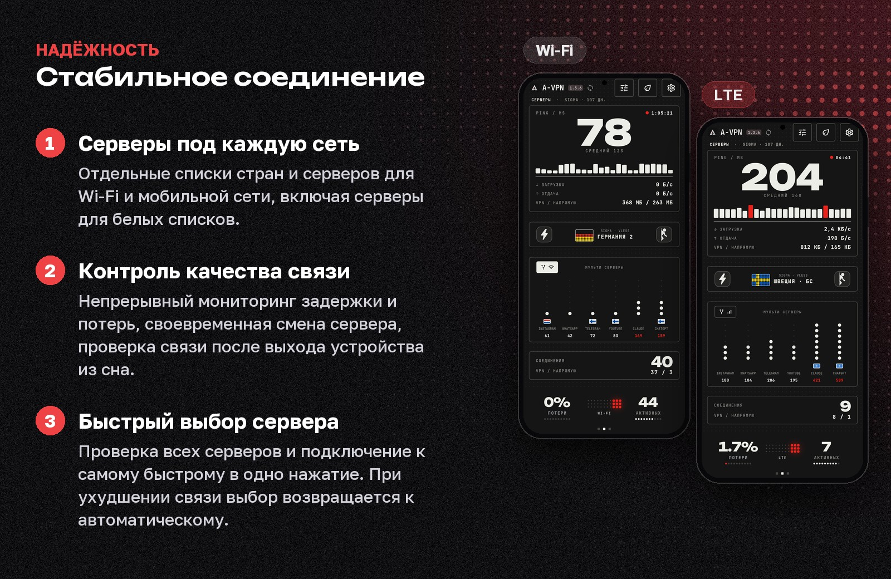
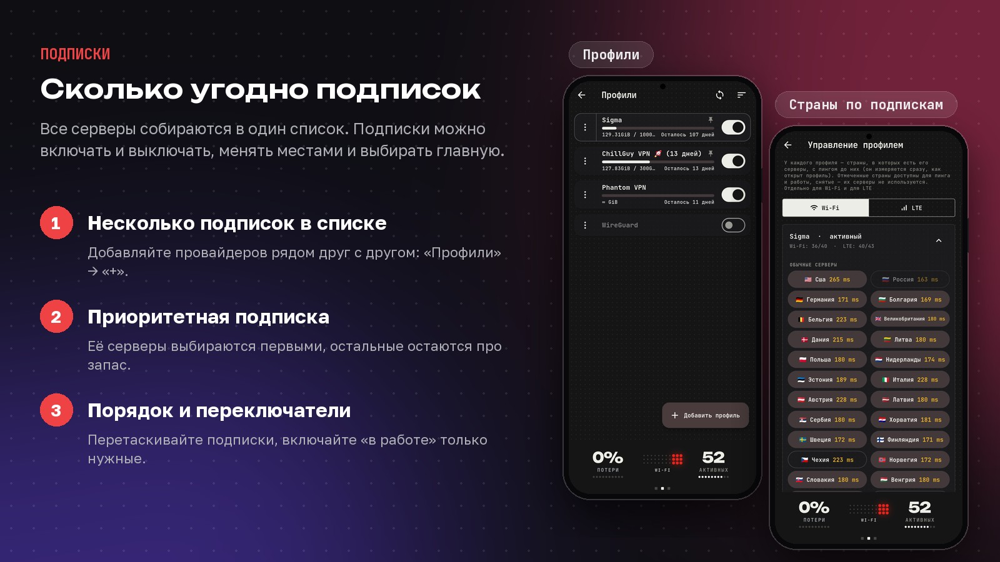
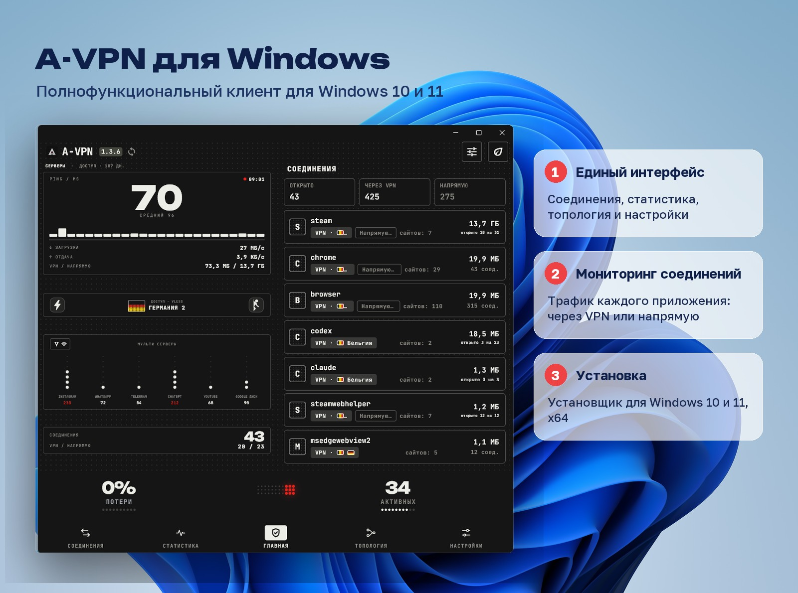
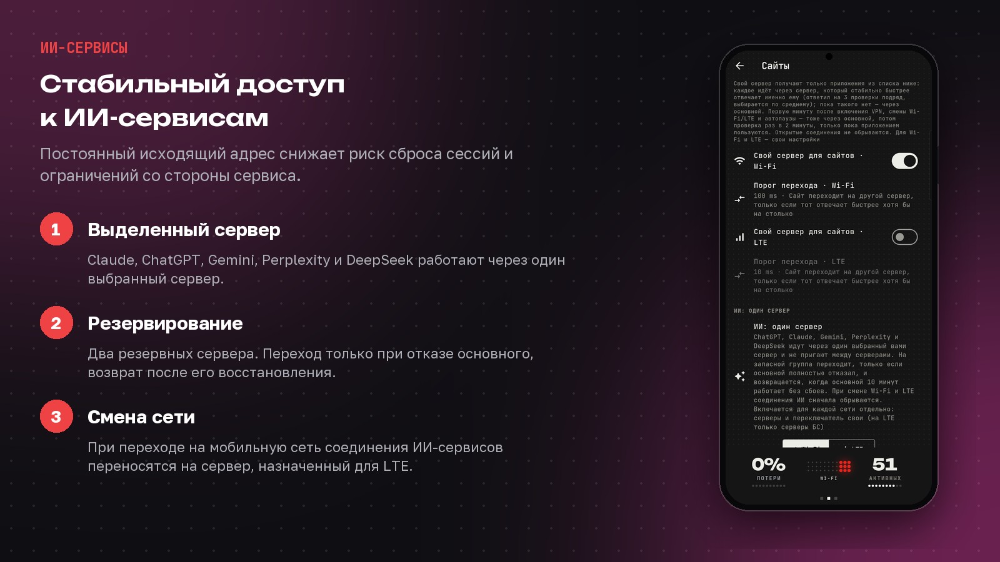
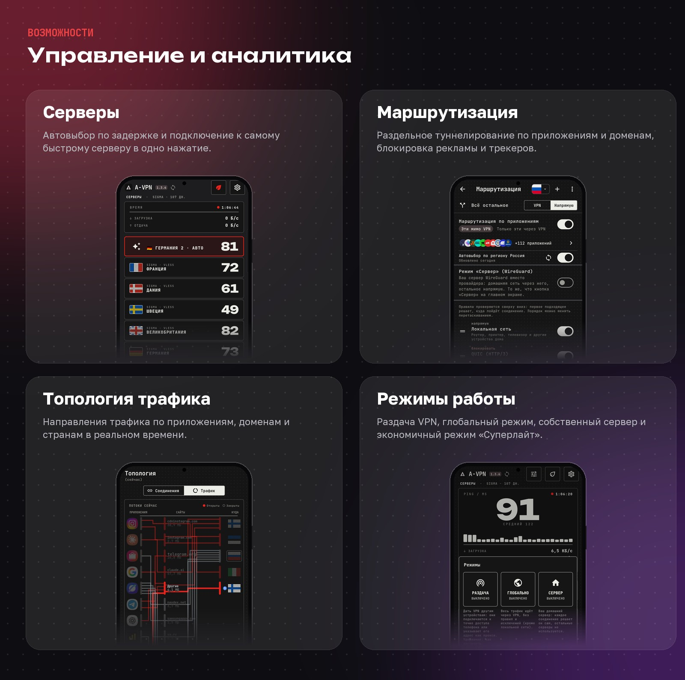
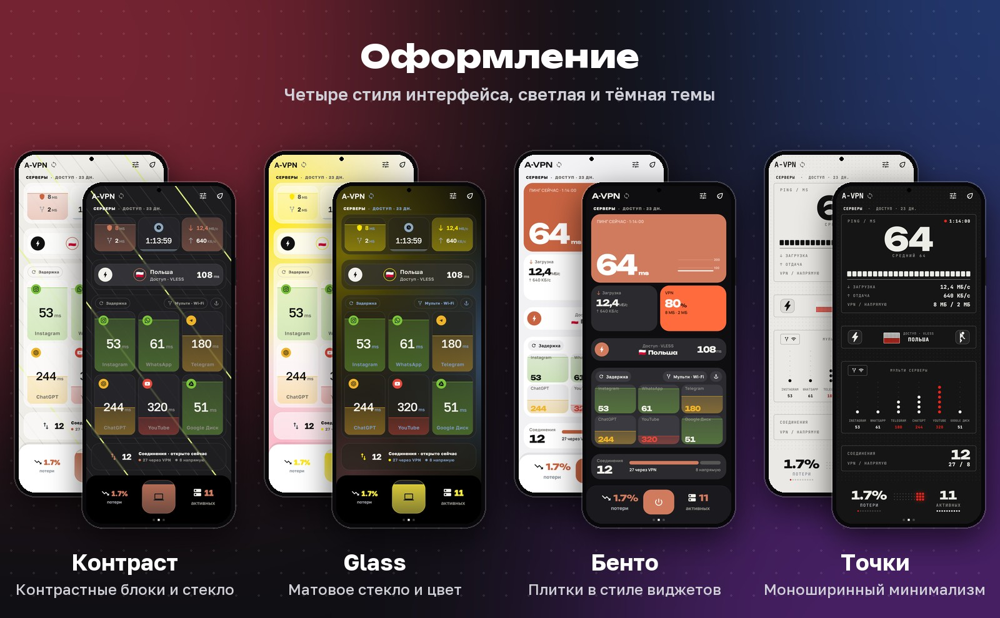
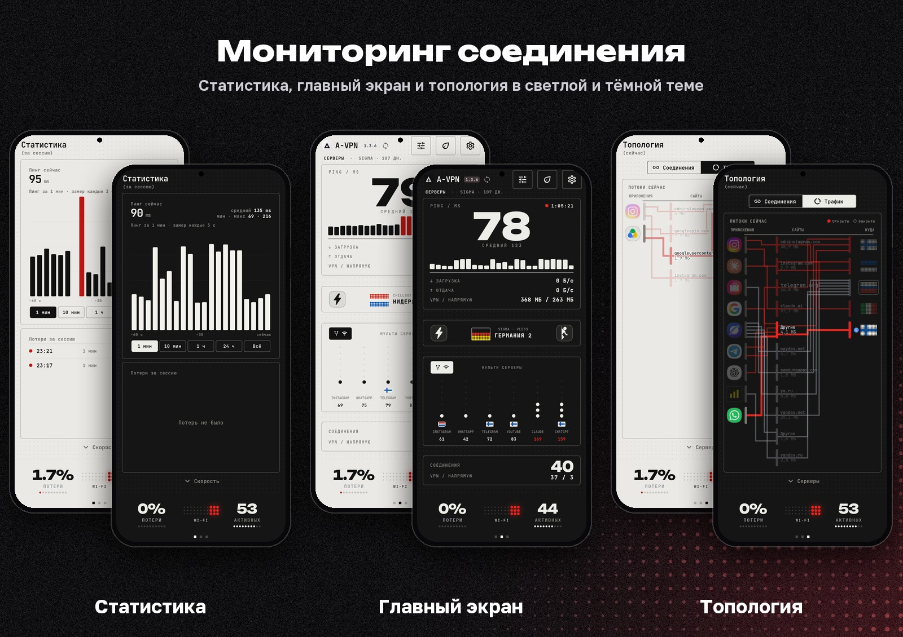
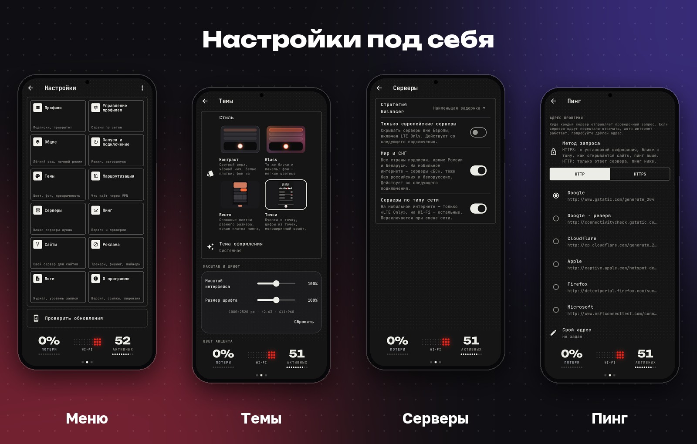

<p align="center">
  
</p>

<h1 align="center">A-VPN</h1>

<p align="center">
  VPN-клиент для Android и Windows на ядре sing-box.
</p>

<p align="center">
  <b>Включите один раз и забудьте.</b><br>
  На телефоне A-VPN сам запускается вместе с системой, выбирает быстрый сервер,<br>
  следит за качеством связи и переключается между Wi-Fi и мобильной сетью.<br>
  Открывать приложение для этого не нужно.
</p>

<p align="center">
  <a href="https://github.com/Aramikkk/A-VPN/releases/latest"></a>
  <a href="https://github.com/Aramikkk/A-VPN/releases"></a>
  
  
  <a href="LICENSE.md"></a>
</p>

<p align="center">
  <a href="https://github.com/Aramikkk/A-VPN/releases/latest/download/A-VPN-arm64.apk"></a>
  <a href="https://github.com/Aramikkk/A-VPN/releases/latest/download/A-VPN-Setup-windows.exe"></a>
</p>

<p align="center"><sub>Всегда последняя версия · <a href="https://github.com/Aramikkk/A-VPN/releases">все релизы и контрольные суммы</a></sub></p>

<p align="center">
  
</p>

## Автоматическое переключение сетей

<p align="center">
  
</p>

На Android A-VPN определяет смену сети и сам применяет набор серверов, назначенный для неё: основной пул в Wi-Fi и серверы для белых списков в мобильной сети. Соединение сохраняется, действий от пользователя не требуется.

## Загрузка

| Платформа | Файл |
|---|---|
| Android 7+, arm64 | `A-VPN-<версия>-arm64.apk` |
| Windows 10+, x64 | `A-VPN-Setup-<версия>-windows.exe` |

Кнопки вверху страницы скачивают последнюю версию. Все релизы, контрольные суммы и подпись: [Releases](https://github.com/Aramikkk/A-VPN/releases/latest). После установки добавьте подписку в разделе «Профили».

## Надёжность соединения

<p align="center">
  
</p>

## Подписки

<p align="center">
  
</p>

## A-VPN для Windows

<p align="center">
  
</p>

## ИИ-сервисы

<p align="center">
  
</p>

Выделенный сервер и два резервных для Claude, ChatGPT, Gemini, Perplexity и DeepSeek настраиваются отдельно для Wi-Fi и LTE в разделе «Настройки» → «Сайты». Постоянный адрес снижает риск сброса сессий, но не гарантирует доступ: правила определяет сам сервис.

## Возможности

<p align="center">
  
</p>

<details>
<summary><b>Полный список возможностей</b></summary>

**Серверы**
- Несколько подписок в едином списке: приоритетная подписка, порядок, отдельное включение.
- Автоматический выбор по задержке с отдельным допуском для Wi-Fi и мобильной сети.
- Выбор самого быстрого сервера в одно нажатие с возвратом к автовыбору при ухудшении связи.
- Режим «Меньше прыжков»: сервер сохраняется, пока соединение стабильно.
- Отдельный сервер для выбранных сервисов и приложений.

**Маршрутизация**
- Режим «Только заблокированное»: остальной трафик идёт напрямую.
- Раздельное туннелирование по приложениям и доменам, готовые группы для российских сервисов, банков и маркетплейсов.
- Блокировка рекламы, трекеров, фишинговых ресурсов и майнеров.
- Автопауза для выбранных приложений и домашней сети с собственным VPN на роутере.

**Аналитика**
- Топология трафика по приложениям, доменам и странам.
- Объём и время работы каждого сервера за сессию, сутки, месяц и весь период.
- История задержки и потерь, трафик по приложениям.

**Энергосбережение**
- Режим «Суперлайт»: только основные показатели, реже проверки, минимальная нагрузка.
- Ночной режим: реже опросы и пробуждения устройства.
</details>

## Интерфейс

<p align="center">
  
</p>

<p align="center">
  
</p>

<p align="center">
  
</p>

<sub>Стили оформления показаны на демонстрационных данных.</sub>

## Установка и проверка подлинности

- **Android:** установите `A-VPN-<версия>-arm64.apk`, разрешив установку из этого источника.
- **Windows:** запустите `A-VPN-Setup-<версия>-windows.exe`. Установщик не подписан сертификатом издателя, поэтому SmartScreen может показать предупреждение: сверьте контрольную сумму и выберите «Подробнее» → «Выполнить в любом случае».

Контрольные суммы опубликованы рядом с файлами (`sha256sum -c <файл>.sha256`). Все APK подписаны одним ключом, SHA-256 сертификата:

```
95:CC:05:9F:8E:1A:E2:E0:B8:59:43:66:6E:C4:5D:D3:2D:66:F8:1E:80:7B:3F:6E:7A:D6:CD:75:BE:A6:B1:9A
```

На Android приложение ежедневно проверяет наличие обновлений в Releases. Загрузка идёт в несколько потоков с докачкой, файл проверяется по SHA-256.

## Конфиденциальность

A-VPN не собирает телеметрию и аналитику. Кроме проверки связи по выбранному адресу, приложение обращается только к github.com за обновлениями. Подписки и статистика хранятся на устройстве, журналы очищаются от ссылок и ключей.

## Сборка

Релизы собираются в GitHub Actions ([`release.yml`](.github/workflows/release.yml)): ядро с патчами, подписанный APK и установщик для Windows. Для локальной сборки требуются Flutter 3.38.5, JDK 17, Android SDK с NDK 28, Go и `gomobile`.

## Поддержка

- Вопросы: [Discussions](https://github.com/Aramikkk/A-VPN/discussions)
- Ошибки и предложения: [Issues](https://github.com/Aramikkk/A-VPN/issues/new/choose). Укажите версию, устройство и журнал из «Настройки» → «Логи», без ссылки на подписку.
- Уязвимости: [приватное сообщение](https://github.com/Aramikkk/A-VPN/security/advisories/new)

Проект бесплатный. Поддержать разработку можно в разделе «О программе».

## Лицензия

A-VPN основан на [Hiddify](https://github.com/hiddify/hiddify-app) и распространяется по лицензии **Hiddify Extended GPL v3** ([`LICENSE.md`](LICENSE.md)). Проект не связан с командой Hiddify и не одобрен ею. Коммерческое использование без письменного разрешения запрещено. Отличия от исходного проекта описаны в [`avpn/CHANGELOG.md`](avpn/CHANGELOG.md), патчи ядра `hiddify-core` 5.4.0 находятся в [`avpn/core54-patches`](avpn/core54-patches).

Благодарим команду Hiddify, проект [sing-box](https://github.com/SagerNet/sing-box) и авторов используемых библиотек.
